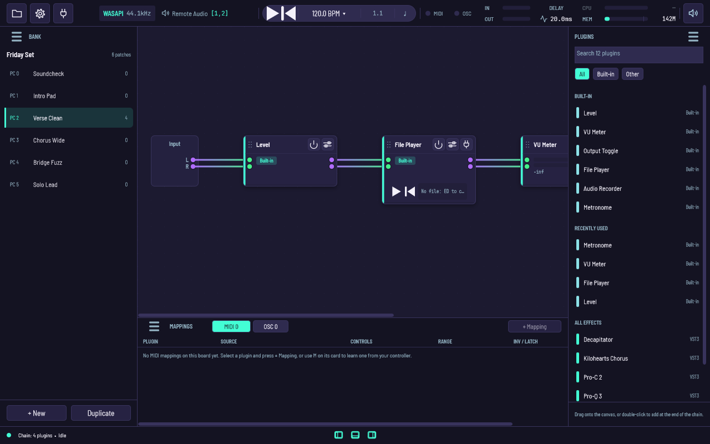
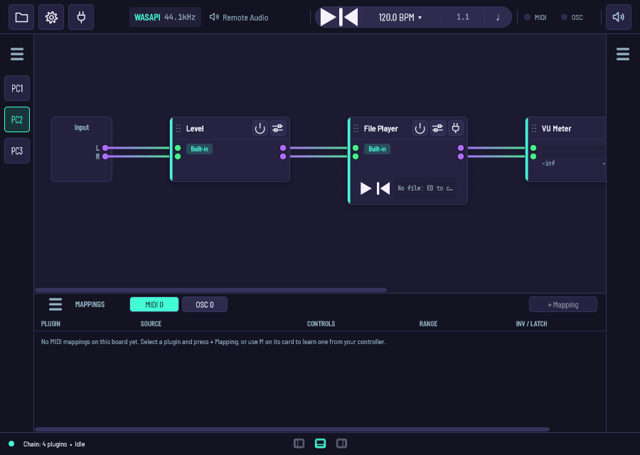
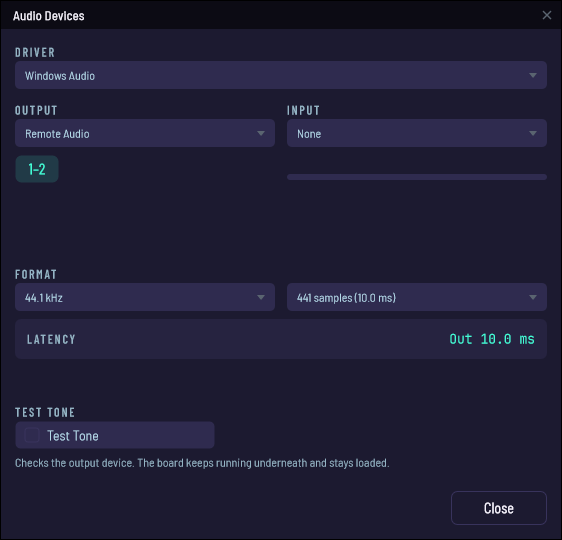
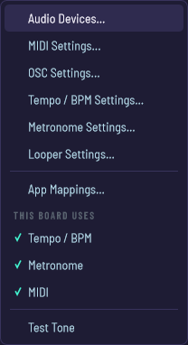

# Pedalboard 3

A plugin host for playing live. Build a chain of VST3s, save it as a patch,
put the patches in a bank, and switch between them with a footswitch while
you're on stage.

It's a ground-up rebuild of Niall Moody's
[Pedalboard2](https://www.niallmoody.com/work/pedalboard2/) (2013), which
predates VST3 and doesn't get built for current machines any more.



Bank on the left, board in the middle, plugin browser on the right. Mappings
along the bottom; transport, meters and the latency/CPU/memory readouts on
top.

## What it does

- **Banks of patches.** Send Program Change 3, you're on patch 3. That's the
  whole point of the program.
- **MIDI and OSC mappings.** Point a CC, note, program change or pitch bend at
  any plugin parameter, or hit Learn and move the knob.
- **Built-in nodes.** Level, VU meter, output toggle, file player, recorder,
  metronome, looper.
- **A transport** with a play head the plugins can see, so tempo-synced delays
  line up.
- **Separate in and out metering**, so when it goes quiet you can tell which
  side of the board went quiet.

VST3 everywhere, AU on macOS, LV2 on macOS and Linux. CLAP and VST2 are build
flags (`PB3_ENABLE_CLAP`, `PB3_ENABLE_VST2`), off in every preset, so no
release carries either. VST2 also needs a copy of the SDK — Steinberg stopped
giving it out, so there is nothing to download; drop yours at
`app-v3/vst2_sdk/` and configure with `-DPB3_ENABLE_VST2=ON`. Without it the
configure stops and says so.

## On a small screen

Laptop on a music stand is the normal case, so the top bar spends its
whitespace before it folds anything away, and the panels collapse to a strip.



## Audio setup



WASAPI, DirectSound and ASIO on Windows, CoreAudio on macOS, ALSA and JACK on
Linux. The test tone puts a 440 Hz sine on the output so you can check the
cable before blaming the board.

Unplug an interface and plug it back in and it comes back. The output never
falls back to laptop speakers on its own.

## Turning off what you don't use



Each feature is switched on app-wide in Settings and then per board, so
opening someone else's bank asks first. Tempo, metronome and looper start off;
MIDI on, OSC off.

Cables are separate: a plugin only gets a MIDI cable if it has MIDI pins.

## Status

M1–M6 are merged — stability, live MIDI/OSC control, banks with Program
Change switching, the mappings UI, the crash guard and `.pdl` safety, and the
parity tail. So are the finish pass, the UI refresh and the chrome pass.

Next is 1.0.0-beta.1. The version, release pipeline, Windows installer and
portable zip all exist; what's left is hands-on use and a few decisions.

- Where things stand: [`docs/status/2026-09-14-handoff.md`](docs/status/2026-09-14-handoff.md)
- Open work: milestones M7, M8 and 1.x on GitLab
- Releases are cut by hand off main: [`docs/releases/README.md`](docs/releases/README.md)
- Roadmap: [`docs/plans/2026-07-02-001-feat-road-to-1-0-release-plan.md`](docs/plans/2026-07-02-001-feat-road-to-1-0-release-plan.md)

## Building it

JUCE 8, CMake, C++20, Catch2. Windows is the primary target; macOS and Linux
build and are covered by CI.

### Windows

Any PowerShell — the script finds the Visual Studio developer environment
itself. You need VS with the C++ workload.

```powershell
./build.ps1 build                  # Debug
./build.ps1 build -Config release  # RelWithDebInfo
./build.ps1 test                   # build, then unit tests
./build.ps1 run
./build.ps1 snapshots              # every window, menu and dialog to build/ui-snapshots
./build.ps1 package                # release build + portable zip (+ installer, with Inno Setup)
./build.ps1 clean
```

The screenshots above came out of `snapshots`, which is also how the UI gets
reviewed without clicking through it.

### macOS and Linux

`just` picks the host's preset. The `Makefile` has the same targets.

```bash
just build
just test
just run
just release
```

Or CMake directly:

```bash
cmake --preset linux-dev -S app-v3
cmake --build --preset linux-dev
ctest --preset linux-dev --output-on-failure
```

macOS needs Xcode's command-line tools (`xcode-select --install`) and
`brew install cmake ninja just pkg-config`.

Linux needs CMake 3.25+, Ninja, a C++20 compiler (CI uses clang-18) and
JUCE 8's X11 and audio libraries:

```
build-essential pkg-config clang-18
libasound2-dev libjack-jackd2-dev
libx11-dev libxrandr-dev libxinerama-dev libxcursor-dev
libxext-dev libxcomposite-dev libxrender-dev
libfreetype-dev libfontconfig1-dev
libgl-dev libglu1-mesa-dev mesa-common-dev
```

It builds with `JUCE_USE_CURL=0` and `JUCE_WEB_BROWSER=0`, so no libcurl or
WebKit needed.

## Where things are

```
app-v3/src/           engine/, session/, control/, ui/, platform/, tools/
app-v3/tests/         Catch2 — unit/ mirrors src/
docs/                 plans/, design/, releases/, status/, screenshots/
installer/windows/    Inno Setup script
tools/                packaging scripts
legacy/               Pedalboard2's end-user docs, for reference
source code/          original Pedalboard2 source — READ-ONLY, never built
vercel-ui-demo/       the UI mockup the design follows
AGENTS.md             conventions, including for coding agents
```

## Licence

**AGPLv3** — see [LICENSE](LICENSE). Copyright (c) 2026 OpenZephyr LLC.

Use it, study it, change it, share it; anything built on it stays under the
same licence. The "Affero" part adds one thing to the GPL: run a modified
version as a network service and its users get the source too.

That wasn't a free choice. JUCE 8's open-source track is AGPLv3, the VST3 SDK
JUCE bundles is Steinberg-proprietary or GPLv3, and Pedalboard2 was
GPLv3-or-later. AGPLv3 is the one licence all three fit under.

Everything else is in
[THIRD-PARTY-NOTICES.md](THIRD-PARTY-NOTICES.md), including which option is
taken where a dependency offers a choice. The original Pedalboard2 in
`source code/` keeps its own GPLv3-or-later licence (Niall Moody, 2009–2013);
nothing in it is compiled and nothing in it ships.

### Contributing

Your copyright stays yours, under the AGPLv3, with a
[Developer Certificate of Origin](CONTRIBUTING.md) sign-off — `git commit -s`,
not a CLA. Nobody gets the right to relicense your code.

Paid features, if they happen, get built as separate components beside this
application rather than as code inside it, so what's in this repository stays
AGPLv3 and complete.
