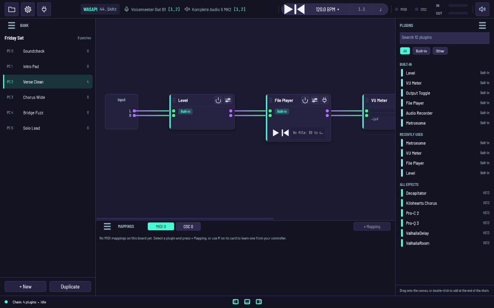
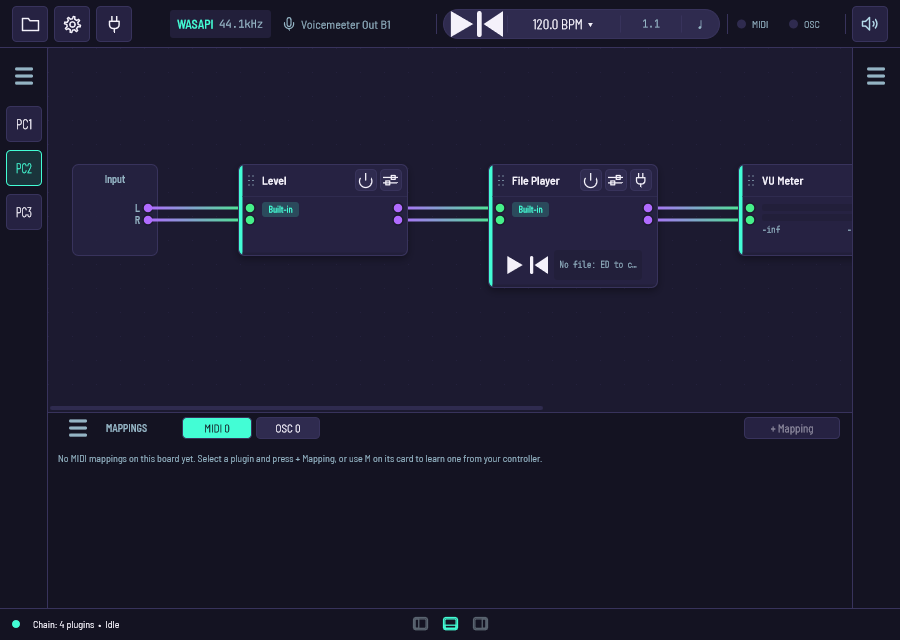
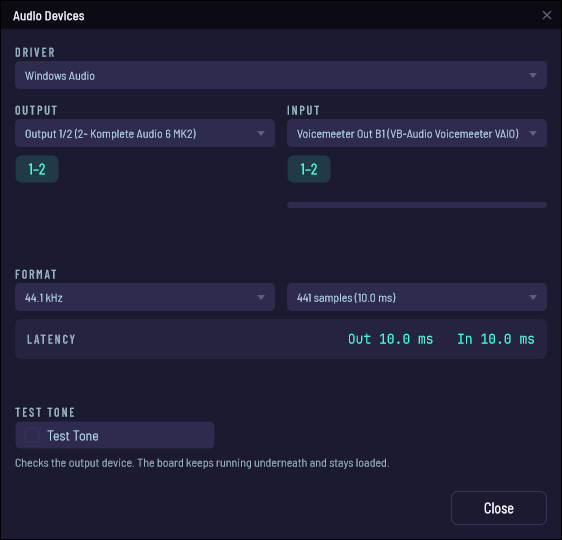
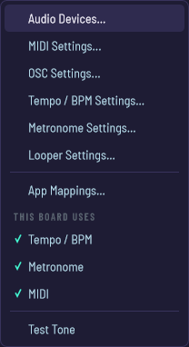

# Pedalboard 3

A plugin host for playing live. Build a chain of VST3s, save it as a patch,
put the patches in a bank, and switch between them with a footswitch while
you're on stage.

It's a ground-up rebuild of Niall Moody's
[Pedalboard2](https://www.niallmoody.com/work/pedalboard2/) (2013), which
predates VST3 and doesn't get built for current machines any more. It still
opens Pedalboard2 `.pdl` files.



Bank on the left, board in the middle, plugin browser on the right. Mappings
along the bottom; transport, meters and the latency/CPU/memory readouts on
top.

## Download

**[Latest release](https://github.com/AquaOctet/PedalBoard3/releases/latest)**
— Windows installer or portable zip, macOS universal, Linux x64. Also on
[GitLab](https://gitlab.com/void-realm-solutions/pedalboard-3/-/releases).

This is a **beta**. It's used regularly on Windows and all three platforms are
built and tested on every change, but macOS and Linux get far less hands-on
use. Keep backups of boards you care about, and read the
[release notes](docs/releases/) for the known limitations — the app isn't
signed yet, so Windows SmartScreen and macOS Gatekeeper will both warn you the
first time.

## Quick start

1. **Pick your audio device.** Settings > Audio Devices. The test tone puts a
   440 Hz sine on the output, so you can check the cable before blaming the
   board.
2. **Scan for plugins.** Plugins > Plugin List. Scanning runs in a separate
   process, so a plugin that crashes while being scanned can't take the app
   down.
3. **Build a chain.** Drag plugins from the right-hand browser onto the board,
   or double-click one to add it at the end.
4. **Save the bank.** Each patch in it gets a number, shown as `PC 0`, `PC 1`
   and so on down the left.
5. **Switch patches with your feet.** Send MIDI Program Change 3 from a
   footswitch and you're on patch 3. Nothing to configure — that's the whole
   point of the program.

## What it does

- **Banks of patches**, switched by Program Change.
- **MIDI and OSC mappings.** Point a CC, note, program change or pitch bend at
  any plugin parameter, or hit Learn and move the knob. App-wide mappings
  cover things like next and previous patch.
- **Built-in nodes.** Level, VU meter, output toggle, file player, recorder,
  metronome, looper.
- **A transport** with a play head the plugins can see, so tempo-synced delays
  line up.
- **Separate in and out metering**, so when it goes quiet you can tell which
  side of the board went quiet.
- **Undo and redo**, Open Recent, and opening a board by dropping it on the
  window. The window remembers its size and position.
- **Missing plugins don't break a patch.** They open as placeholders and the
  rest of the board plays.

Plugin formats: VST3 everywhere, AU on macOS, LV2 on macOS and Linux. No CLAP
or VST2 in released builds.

### On a small screen

Laptop on a music stand is the normal case, so the top bar spends its
whitespace before it folds anything away, and the panels collapse to a strip.



### Audio setup



WASAPI, DirectSound and ASIO on Windows, CoreAudio on macOS, ALSA and JACK on
Linux. Unplug an interface and plug it back in and it comes back; the output
never falls back to laptop speakers on its own.

### Turning off what you don't use



Each feature is switched on app-wide in Settings and then per board, so
opening someone else's bank asks first. Tempo, metronome and looper start off;
MIDI on, OSC off.

Cables are separate: a plugin only gets a MIDI cable if it has MIDI pins.

## Building from source

JUCE 8, CMake 3.25+, C++20, Catch2. Windows is the primary target; macOS and
Linux build and are covered by CI.

```powershell
./build.ps1 build        # Windows: any PowerShell, finds VS itself
./build.ps1 test
./build.ps1 run
```

```bash
just build               # macOS and Linux; the Makefile has the same targets
just test
just run
```

Full prerequisites, the other build targets, the CLAP and VST2 flags and the
repository layout are in [CONTRIBUTING.md](CONTRIBUTING.md).

Development happens on
[GitLab](https://gitlab.com/void-realm-solutions/pedalboard-3), which is where
CI runs and where the open work lives; GitHub is a mirror.

## Licence

**AGPLv3** — see [LICENSE](LICENSE). Copyright (c) 2026 OpenZephyr LLC.

Use it, study it, change it, share it; anything built on it stays under the
same licence. The "Affero" part adds one thing to the GPL: run a modified
version as a network service and its users get the source too.

That wasn't a free choice. JUCE 8's open-source track is AGPLv3, the VST3 SDK
JUCE bundles is Steinberg-proprietary or GPLv3, and Pedalboard2 was
GPLv3-or-later. AGPLv3 is the one licence all three fit under.

Everything else is in
[THIRD-PARTY-NOTICES.md](THIRD-PARTY-NOTICES.md), including which option is
taken where a dependency offers a choice. The original Pedalboard2 in
`source code/` keeps its own GPLv3-or-later licence (Niall Moody, 2009–2013);
nothing in it is compiled and nothing in it ships.

### Contributing

Your copyright stays yours, under the AGPLv3, with a
[Developer Certificate of Origin](CONTRIBUTING.md) sign-off — `git commit -s`,
not a CLA. Nobody gets the right to relicense your code.

Paid features, if they happen, get built as separate components beside this
application rather than as code inside it, so what's in this repository stays
AGPLv3 and complete.
