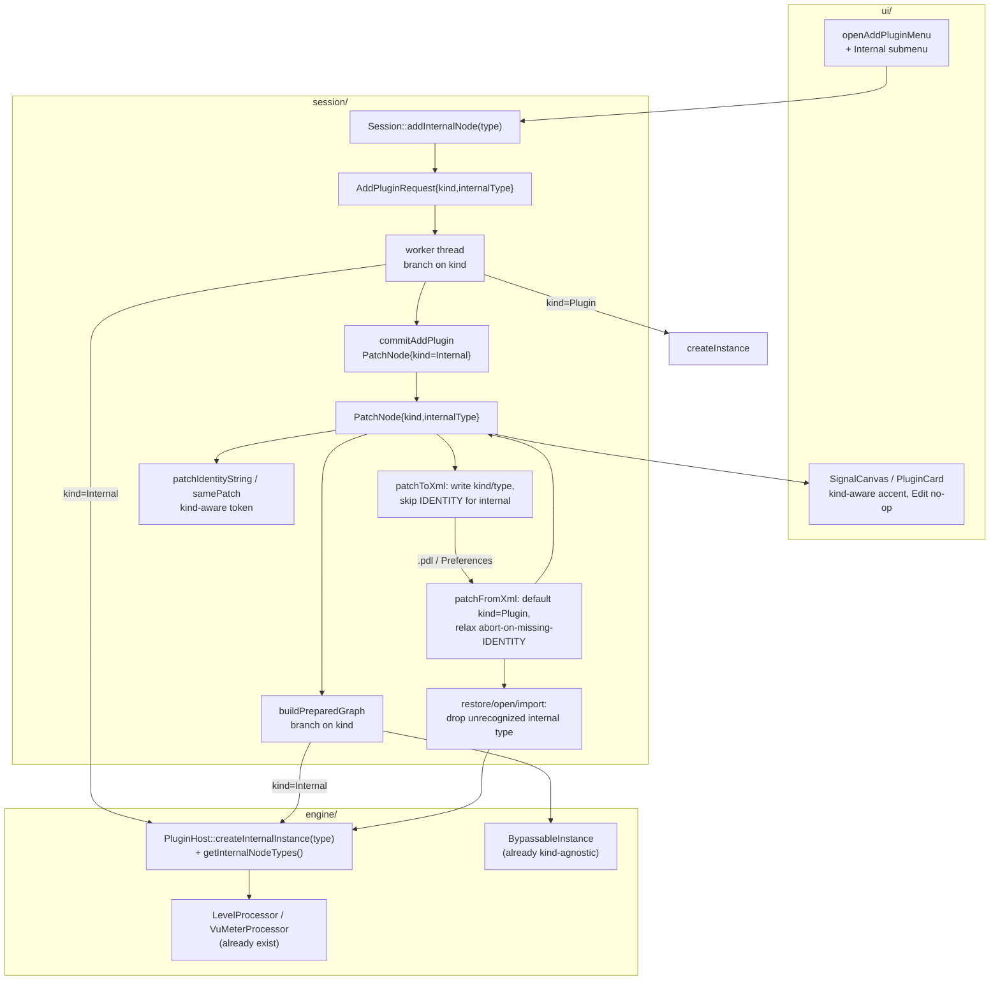

# feat: Internal-node add-path (built-in graph nodes)

## Summary

Let the user add **built-in (non-plugin) nodes** to a patch — starting with the already-shipped
`LevelProcessor` and `VuMeterProcessor` — and have them serialize to `.pdl`, restore on launch, and
appear in the chain alongside hosted plugins. Today `session::PatchNode` *is* a
`juce::PluginDescription` (plugin-only), so the internal processors compiled into the binary are
dead weight: nothing can instantiate them in the graph. This plan threads an explicit **node-kind
discriminator** (`Plugin` | `Internal` + an `internalType` token) through the data model →
serialization → graph build → Session add → host factory → restore/crash-loop → UI add menu. It is
the structural unlock for the rest of Phase 5 (File Player, Recorder, Looper, Metronome, MIDI Out)
and a prerequisite for drag-drop-creates-FilePlayer (origin AC-FP-6).

The schema (`<NODE kind="internal" type="...">`) and the decision to use an explicit discriminator
rather than v2's synthetic `PluginDescription` are already fixed by the master plan
(`docs/plans/2026-04-12-001-feat-pedalboard-3-rewrite-plan.md` §4.5 and §4.3 Phase 1 internal set).

---

## Problem Frame

Per the parity review (`docs/reviews/2026-06-16-pedalboard2-parity-review.md`), Pedalboard 3's single
biggest *structural* gap toward Pedalboard2 parity in the graph is that **it has no concept of a
built-in node**. Pedalboard2 exposed Level, VU, File Player, Recorder, Looper, Metronome, Output
Toggle, and MIDI Out as internal nodes the user adds like any plugin. PB3 can only add scanned VST3
effects. Two production internal processors (`LevelProcessor`, `VuMeterProcessor`) already exist and
are unit-tested, but every code path that materializes a node calls `host.createInstance(desc)` on a
`juce::PluginDescription`, so an internal `juce::AudioProcessor` cannot be represented, added,
saved, or restored.

This plan does **not** build new DSP — it builds the *path* that makes built-in nodes first-class.
Scoped to stereo-in/stereo-out effect internals (Level, VU), it slots into the existing linear-chain
connection model with zero changes to `linearChainConnections`, `validatePatch`, or
connection-resolution — deferring the structural risk of endpoint/MIDI internals.

---

## Requirements

- **R1** — A user can add a built-in node (Level, VU) to the active patch from the UI, even when no
  plugins are scanned. (origin: Phase 5 internal-node set; parity review §D, §E)
- **R2** — A patch containing internal nodes round-trips through `.pdl` save/load and Preferences
  auto-restore, preserving node kind, type, order, bypass, and custom name. (origin AC-FS schema §4.5)
- **R3** — Internal nodes instantiate in the live `AudioProcessorGraph` and process audio (Level
  applies gain; VU meters and passes through). (origin Phase 5)
- **R4** — Back-compat: a `.pdl`/auto-restore file written before this change (no `kind` attribute)
  loads unchanged, every node treated as `Plugin`. (origin AC-FS-3)
- **R5** — An unrecognized internal `type` (e.g. a newer schema's node opened by an older binary) is
  **dropped with the rest of the patch preserved**, never aborting the whole load or crashing the host.
  (origin AC-PS-5, AC-FS-3; parity review PART 2 risk 1)
- **R6** — The crash-loop guard and dirty-tracking distinguish internal node types (today both hash to
  `"::"`, colliding). (parity review PART 2 risk 3)

---

## Key Technical Decisions

### KTD-1 — Explicit `NodeKind` discriminator on `PatchNode`, not a synthetic `PluginDescription`

Add `NodeKind kind { Plugin }` + `juce::String internalType` to `PatchNode`. For `Plugin` nodes,
`desc`/`state` stay authoritative; for `Internal`, `desc` is unused and `internalType` (e.g.
`"LevelProcessor"`) is the identity. Rationale: the master plan §4.5 already specifies the
`kind`/`type` XML and explicitly rejected v2's `InternalFilters` synthetic-descriptor approach
(`source code/src/InternalFilters.h`), which conflated internal identity with plugin identity and
broke crash-loop hashing. Defaulting `kind` to `Plugin` makes the field additive and back-compatible.

### KTD-2 — One internal-processor factory, owned by `PluginHost`

`PluginHost` already owns instance creation (`createInstance`), so add
`createInternalInstance(type, sr, blockSize, errorOut)` → `std::unique_ptr<juce::AudioProcessor>`
switching on the type token, plus `getInternalNodeTypes()` (id + display name) for the Add menu and
validation. The factory returning `nullptr` for an unknown type **is** the safety check (the internal
analogue of `isDescriptorSafeForChain`). Both the worker-thread add and `buildPreparedGraph` call this
one factory, keeping the type→class table in a single place.

### KTD-3 — Widen the "hosted instance" type from `AudioPluginInstance*` to `AudioProcessor*`

`PreparedGraph::NodeRefs::hosted` and `Session::AddPluginResult::hosted` are typed
`juce::AudioPluginInstance*`; internal nodes are plain `juce::AudioProcessor`. Widen to
`juce::AudioProcessor*` (null-safe at every consumer) rather than adding a parallel pointer.
`BypassableInstance` is already kind-agnostic — it takes `std::unique_ptr<juce::AudioProcessor>` and
`getHostedProcessor()` returns `juce::AudioProcessor*` — so the wrapper needs no change. The ripple is
to `Session::getHostedPlugin` (public, UI-facing), state-capture, and `SignalCanvas::onCardEdit`.

### KTD-4 — Scope to stereo effect internals; defer endpoint/MIDI internals

Level and VU are stereo-in/stereo-out, so they fit `linearChainConnections`' bus-uniform assumption
with no change. True endpoint/MIDI internals (AudioInput/Output, MIDI Out) violate it and would need
per-node bus metadata — deferred. This keeps `validatePatch` and connection code untouched.

### KTD-5 — Schema bump is `kSchemaMinor` only

`kind`/`type` are additive `<NODE>` attributes; bump `kSchemaMinor` (major stays 3 per §4.5). Old
binaries still accept the file's major and ignore the unknown attributes; new binaries default absent
`kind` to `Plugin`. (Note: true forward-compat *preservation* of unknown elements remains
unimplemented and out of scope — see Scope Boundaries.)

---

## High-Level Technical Design

The discriminator flows through every layer that materializes or persists a node. The diagram shows
where `kind`/`internalType` is read/written and where the factory replaces `createInstance`.

Directional guidance, not implementation specification — prose and per-unit fields are authoritative.

---

## Implementation Units

### U1. Add the `NodeKind` discriminator to the data model

**Goal:** `PatchNode` can represent a built-in node; everything still defaults to `Plugin`.
**Requirements:** R1, R2, R4.
**Dependencies:** none.
**Files:** `app-v3/src/session/Patch.h`, `app-v3/tests/unit/session/Patch_test.cpp`.
**Approach:** Add `enum class NodeKind { Plugin, Internal };`, and to `PatchNode`:
`NodeKind kind { NodeKind::Plugin }` + `juce::String internalType`. Document that `desc`/`state` are
meaningful only for `Plugin` and `internalType` only for `Internal`. No change to `validatePatch`
(already `desc`-agnostic).
**Patterns to follow:** the existing `PatchNode` struct + doc-comment style in `Patch.h`.
**Test scenarios:**
- A default-constructed `PatchNode` has `kind == NodeKind::Plugin` and empty `internalType` (back-compat default).
- A patch mixing a plugin node and an internal node still passes `validatePatch == Ok`.
**Verification:** `PatchNode` carries `kind`/`internalType`; the suite compiles and existing Patch tests pass.

### U2. Internal-processor factory in `PluginHost`

**Goal:** one place that maps a type token to a built-in `juce::AudioProcessor` and lists the available types.
**Requirements:** R1, R3, R5.
**Dependencies:** none (U1 not required to compile the factory).
**Files:** `app-v3/src/engine/PluginHost.h`, `app-v3/src/engine/PluginHost.cpp`,
`app-v3/tests/unit/engine/PluginHost_test.cpp`.
**Approach:** Add `std::unique_ptr<juce::AudioProcessor> createInternalInstance(const juce::String& type,
double sampleRate, int blockSize, juce::String& errorOut)` switching on the token →
`std::make_unique<processors::LevelProcessor>()` / `VuMeterProcessor`; unknown type → `nullptr` + a
user-presentable `errorOut`. Add `getInternalNodeTypes()` returning `{ typeId, displayName }` pairs
(e.g. `{"LevelProcessor","Level"}`, `{"VuMeterProcessor","VU Meter"}`). The factory pre-warms nothing
(callers prepare); keep the type→class table the single source of truth.
**Patterns to follow:** `PluginHost::createInstance` / `getKnownEffects` shape; the processor
construction in `tests/.../*Processor_test.cpp`.
**Test scenarios:**
- `createInternalInstance("LevelProcessor",...)` returns a non-null processor whose `getName() == "Level"`.
- `createInternalInstance("VuMeterProcessor",...)` returns a processor named `"VU Meter"`.
- `createInternalInstance("Nonexistent",...)` returns `nullptr` and sets a non-empty `errorOut`.
- `getInternalNodeTypes()` contains exactly the two known types with stable ids + display names.
**Verification:** the factory builds Level/VU by token and rejects unknown tokens.

### U3. Branch `buildPreparedGraph` on kind; widen `NodeRefs::hosted`

**Goal:** an internal node instantiates in the live graph and processes audio.
**Requirements:** R3, KTD-3.
**Dependencies:** U1, U2.
**Files:** `app-v3/src/session/PreparedGraph.h`, `app-v3/src/session/PreparedGraph.cpp`,
`app-v3/tests/unit/session/PreparedGraph_test.cpp`.
**Approach:** In the node loop, branch on `patchNode.kind`: `Plugin` → existing
`host.createInstance(desc)`; `Internal` → `host.createInternalInstance(internalType,...)`. Wrap both
in `BypassableInstance` (unchanged). On factory `nullptr` for an internal, set `errorOut` and abort
the build exactly like a failed plugin instance (callers are responsible for having filtered unknown
types first — U6). Widen `NodeRefs::hosted` from `juce::AudioPluginInstance*` to
`juce::AudioProcessor*`; populate it from `BypassableInstance::getHostedProcessor()` for both kinds.
**Patterns to follow:** the existing plugin-instantiation block + `NodeRefs` recording in
`buildPreparedGraph`; the graph-build test harness in `PreparedGraph_test.cpp`.
**Test scenarios:**
- A patch with a single `LevelProcessor` internal node builds a valid graph (`isValid()`), and an
  offline render at `level = 1.0` doubles a DC input (proves the internal node is in the chain).
- A patch mixing a plugin (use an existing test-double path if available) and an internal node builds
  and both nodes appear in `result.nodes`.
- An internal node with an unrecognized `internalType` yields an empty `PreparedGraph` with a
  non-empty `errorOut` (build aborts cleanly, no crash).
- `NodeRefs::hosted` for an internal node points at the internal processor (non-null,
  `getName()`-checkable) — proving the widened type is populated.
**Verification:** internal nodes render audio through a real graph; `hosted` is `AudioProcessor*`-typed
and populated for both kinds.

### U4. `Session::addInternalNode` + kind-aware add pipeline

**Goal:** the app can add a built-in node to the active patch through the same worker pipeline as plugins.
**Requirements:** R1, R3.
**Dependencies:** U1, U2, U3 (shares the `hosted` widening).
**Files:** `app-v3/src/session/Session.h`, `app-v3/src/session/Session.cpp`,
`app-v3/tests/unit/session/Session_test.cpp`.
**Approach:** Add `void addInternalNode(juce::String internalType)`. Widen `AddPluginRequest` with
`NodeKind kind` + `internalType` (keep the bounded latest-wins FIFO mailbox). In the worker, branch:
`Plugin` → `createInstance`, `Internal` → `createInternalInstance`; pre-warm
(`setRateAndBufferSizeDetails` + `prepareToPlay`) applies to both. Widen `AddPluginResult::hosted` to
`juce::AudioProcessor*`. In `commitAddPlugin`, build the `PatchNode` with `kind`/`internalType` set.
Populate `NodeSnapshot::name` from the internal display name (processor `getName()` or the factory's
type table) when `kind == Internal`. Make `getHostedPlugin` kind-safe (return null for internals, or
re-type — see U3 ripple) so UI callers don't dereference a plugin API on an internal.
**Patterns to follow:** the existing `addPlugin` → `AddPluginRequest` → worker → `commitAddPlugin`
flow; `getNodeSnapshots` name derivation.
**Test scenarios:**
- `addInternalNode("LevelProcessor")` (driven through the Session's add/commit cycle) results in the
  active patch gaining a node with `kind == Internal`, `internalType == "LevelProcessor"`, and a
  non-empty snapshot `name`.
- After adding an internal node, the live graph contains it and audio routes through it (integration:
  add → commit → render).
- Adding an internal node leaves existing plugin nodes and connections intact; the linear chain is
  rebuilt over all nodes in order.
- `getHostedPlugin(id)` for an internal node does not return a dangling/invalid plugin pointer (null
  or kind-safe).
**Verification:** an internal node can be added end-to-end and is reflected in patch + graph + snapshots.

### U5. Serialize node kind/type through `.pdl` and auto-restore

**Goal:** internal nodes survive save/load and Preferences round-trips; old files still load.
**Requirements:** R2, R4, KTD-5.
**Dependencies:** U1.
**Files:** `app-v3/src/session/Patch.cpp`, `app-v3/src/session/PdlSerializer.h`,
`app-v3/tests/unit/session/Patch_test.cpp`, `app-v3/tests/unit/session/PdlSerializer_test.cpp`.
**Approach:** In `patchToXml`, write a `kind` attribute on `<NODE>` (`"plugin"`/`"internal"`); for
`Internal`, write a `type` attribute and **skip** the `<IDENTITY>` child. In `patchFromXml`, read
`kind` defaulting to `"plugin"` when absent (back-compat); for `internal`, read `type` and do **not**
require `<IDENTITY>`; **relax the current early `return nullptr`** so a node legitimately lacking
`<IDENTITY>` does not fail the whole patch. Bump `kSchemaMinor` (major unchanged) and update the
`PdlSerializer.h` doc/example. `PdlSerializer.cpp` needs no logic change (delegates to Patch.cpp).
**Patterns to follow:** the existing NODES write/read block in `Patch.cpp`; the mappings-persistence
back-compat tests already added to `Patch_test.cpp`/`PdlSerializer_test.cpp`.
**Test scenarios:**
- A patch with one plugin node + one internal `LevelProcessor` node round-trips through
  `patchToXml`/`patchFromXml`: the internal node's `kind`/`internalType`/order/`bypass`/`customName`
  reproduce; the plugin node's `desc` reproduces. (Covers R2.)
- The internal node's `<NODE>` element has no `<IDENTITY>` child and carries `kind="internal" type="..."`.
- A hand-built `<NODE>` with **no** `kind` attribute loads as `kind == Plugin` (back-compat). (Covers R4.)
- An internal `<NODE>` with no `<IDENTITY>` does **not** cause `patchFromXml` to return null.
- End-to-end `.pdl`: `writePatch` then `readPatch` of a patch with an internal node succeeds, `error`
  empty, internal node preserved; `validatePatch == Ok`.
- An old `.pdl` (schemaMinor below the bump, no `kind`) still reads with all nodes as `Plugin`.
**Verification:** internal nodes persist and restore; pre-kind files are unaffected.

### U6. Kind-aware identity hashing + unrecognized-type drop filter

**Goal:** the crash-loop guard and dirty-tracking distinguish internal types; an unknown internal type
is dropped (not fatal) at every restore/open/import site.
**Requirements:** R5, R6.
**Dependencies:** U1, U2.
**Files:** `app-v3/src/session/Patch.cpp` (`patchIdentityString`),
`app-v3/src/session/PreferencesPersister.cpp` (`samePatch`), `app-v3/src/App.cpp`
(`restoreActivePatchIfAny`), `app-v3/src/ui/TransportBar.cpp` (`openPatch`),
`app-v3/src/session/v2_import/...` caller as applicable,
`app-v3/tests/unit/session/Patch_test.cpp`, `app-v3/tests/unit/session/PreferencesPersister_test.cpp`.
**Approach:** `patchIdentityString`: emit `"internal::" + internalType` for internal nodes (today it
emits `"::"`, ambiguous + collision-prone). `PreferencesPersister::samePatch`: include
`kind`/`internalType` in the comparator so a Level→VU swap at the same position is seen as a change.
Add a shared "is this node safe to materialize?" predicate used at the three filter sites that today
call `isDescriptorSafeForChain`: for `Plugin`, keep `isDescriptorSafeForChain`; for `Internal`, accept
iff `getInternalNodeTypes()` contains the type — otherwise **drop the node and rebuild
`linearChainConnections` over survivors** (mirroring the existing unsafe-plugin drop). Apply at
`App::restoreActivePatchIfAny`, `TransportBar::openPatch`, and the v2-import open path.
**Patterns to follow:** the existing drop-and-rebuild-chain logic in `App::restoreActivePatchIfAny`;
the `samePatch` comparator fields.
**Test scenarios:**
- `patchIdentityString` differs for a patch with a `LevelProcessor` node vs the same patch with a
  `VuMeterProcessor` node at the same position (no `"::"` collision). (Covers R6.)
- `samePatch` returns false when one patch has a `LevelProcessor` node and the other a
  `VuMeterProcessor` node at the same position (legitimate edit persists).
- A patch containing an internal node with an **unrecognized** `internalType` loads with that node
  **dropped**, the surviving nodes intact, connections rebuilt, and `validatePatch == Ok` — no abort,
  no crash. (Covers R5.)
- A recognized internal node passes the safety filter unchanged.
**Verification:** internal types are distinguishable in the crash-loop/dirty paths; unknown types
degrade gracefully at all three sites.

### U7. UI add menu + node-card affordances for internal nodes

**Goal:** the user can add Level/VU from the toolbar (even with zero scanned plugins), and node cards
render internals correctly.
**Requirements:** R1.
**Dependencies:** U2, U4.
**Files:** `app-v3/src/ui/TransportBar.cpp`, `app-v3/src/ui/SignalCanvas.cpp`,
`app-v3/src/ui/PluginCard.cpp` (as needed).
**Approach:** In `openAddPluginMenu`, add an "Internal" submenu populated from
`getInternalNodeTypes()`, dispatching to `session.addInternalNode(type)`. **The empty-effects
early-return must not block internals** — restructure so internals are always offered even when
`getKnownEffects()` is empty (partition the menu id space or use a sub-menu callback). In
`SignalCanvas`, make `isInstrumentNode`/accent kind-aware (internals are not instruments;
`desc.isInstrument` is meaningless for them). `onCardEdit` already guards on `hasEditor()`; once
`getHostedPlugin` is kind-safe (U4), Edit is a safe no-op for editor-less internals.
**Patterns to follow:** the existing `openAddPluginMenu` PopupMenu construction; `SignalCanvas`
accent logic; `PluginCard` button wiring.
**Execution note:** UI-thread `PopupMenu` interaction is not unit-testable headless; verify the
menu-build + dispatch logic by extracting any non-trivial selection mapping into a testable helper
where practical, and confirm the rest by build + manual smoke on a dev build.
**Test scenarios:**
- (where a helper is extracted) The Add-menu model offers both internal types even when the effects
  list is empty.
- (where a helper is extracted) Selecting an internal entry maps to the correct `internalType` passed
  to `addInternalNode`.
- `Test expectation: limited` — the `PopupMenu` wiring and card rendering are verified by compile +
  manual smoke; only extracted selection-mapping helpers are unit-tested.
**Verification:** Internal submenu appears and adds Level/VU on a dev build, including with no plugins
scanned; cards for internals render without a plugin editor.

---

## System-Wide Impact

- **`getHostedPlugin` is public + UI-facing.** Widening the hosted type ripples to `SignalCanvas`
  (`onCardEdit`) and state-capture (`getActivePatchWithState`); both must become null/kind-safe. This
  is the broadest blast radius — trace every `NodeRefs::hosted` / `AddPluginResult::hosted` consumer.
- **Three identical restore/open/import filter sites** (`App::restoreActivePatchIfAny`,
  `TransportBar::openPatch`, v2-import open) each call `isDescriptorSafeForChain`. The
  unrecognized-internal-type drop must be added at **all three** or one path aborts on an unknown type.
- **Crash-loop marker correctness.** `patchIdentityString` feeds the restore-in-flight hash; the
  current `"::"` for internals would make the guard unable to distinguish internal-only patches and
  could mis-quarantine. Fixing it is a correctness requirement, not cosmetic.
- **Dirty-tracking.** `PreferencesPersister::samePatch` blind to kind would silently *not persist* a
  Level→VU swap — a data-loss bug surfaced by U6.

---

## Scope Boundaries

### In scope
Stereo effect internals (Level, VU): data model, factory, graph build, Session add, serialization,
restore/crash-loop hardening, and the Add-menu/UI affordances to add them.

### Deferred to Follow-Up Work
- **Endpoint / MIDI internals** (AudioInput/Output, MIDI Out) — they break
  `linearChainConnections`' bus-uniform assumption and need per-node bus metadata.
- **Per-node bus metadata** in `linearChainConnections` (the prerequisite for the above).
- **Internal-node state persistence** — Level/VU `get/setStateInformation` are no-ops today; once a
  stateful internal (e.g. File Player) lands, `<STATE>` must round-trip for internals (the
  `LevelProcessor.h` TODO).
- **Custom Level/VU editor windows** and the VU meter UI consumer (the published atomics have no reader yet).
- **New internal processors** (File Player, Recorder, Looper, Metronome, Output Toggle) — each is its
  own DSP increment on top of this path.

### Outside this plan
- **True forward-compat preservation** of unknown `.pdl` elements (origin AC-FS-7) — `patchFromXml`
  reconstructs from known fields only; an old binary reading a *new* internal type still degrades to
  "dropped node" rather than verbatim preservation. Tracked separately.
- Live MIDI/OSC device input, the mapping-creation UI, transport, and multi-patch banks (separate plans).

---

## Risks & Dependencies

- **R-1 (med) — `createInstance`-bypass safety.** Restore/load/add construct processors directly,
  sidestepping scanner guards. Mitigation: the factory's `nullptr`-on-unknown-type + the U6 drop
  filter at all three sites. First-party internals don't crash on construct, so the worst case is
  "node dropped," not "host crash."
- **R-2 (med) — `.pdl` back-compat regressions.** Mitigated by default-to-`Plugin`, the relaxed
  abort-on-missing-`<IDENTITY>`, and the explicit old-file round-trip tests in U5.
- **R-3 (low) — hosted-type widening ripple.** Compile-surfaced; the risk is a missed consumer that
  dereferences a plugin API on an internal. Mitigation: grep every `hosted` use; null-guard.
- **R-4 (low) — UI menu id-space collision** between effects and internals. Mitigation: partition the
  id ranges or use a sub-menu callback (U7).
- **Dependency:** none external. All target code and the two processors already exist on `main`.

---

## Verification (overall)

The plan is complete when: a dev build can add Level and VU from the toolbar with zero plugins
scanned; those nodes process audio in the chain; a saved `.pdl` containing them reopens with kind and
order intact; an old `.pdl` still loads; and a `.pdl` with an unrecognized internal type loads with
that node dropped and the rest intact. CI (headless) covers U1–U6; U7's menu/card wiring is build +
manual smoke.

---

## Sources & Research

- Parity review: `docs/reviews/2026-06-16-pedalboard2-parity-review.md` (PB2↔PB3 feature map, status).
- Master plan (origin): `docs/plans/2026-04-12-001-feat-pedalboard-3-rewrite-plan.md` — §4.5 `.pdl`
  schema (`kind`/`type`, lines ~444-449), §4.3 Phase 1 minimum internal set (~line 322).
- Rejected v2 design: `source code/src/InternalFilters.h` (synthetic `PluginDescription` for internals).
- Ready-to-wire processors: `app-v3/src/engine/processors/LevelProcessor.{h,cpp}`,
  `VuMeterProcessor.{h,cpp}`.
- Add-path touch points (verified): `session/Patch.{h,cpp}`, `session/PreparedGraph.{h,cpp}`,
  `session/Session.{h,cpp}`, `engine/PluginHost.{h,cpp}`, `ui/TransportBar.cpp`, `ui/SignalCanvas.cpp`,
  `App.cpp`, `session/PreferencesPersister.cpp`.
