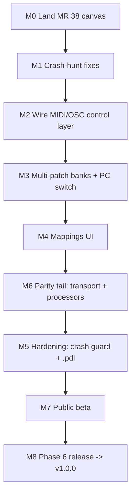

# Road to v1.0.0 Release - Plan

## Goal Capsule

- **Objective:** Sequence the remaining work from the current MVP (interactive-canvas branch, MR !38) to the v1.0.0 public release, with a public beta checkpoint after the live-performer core lands.
- **Product authority:** `docs/plans/2026-04-12-001-feat-pedalboard-3-rewrite-plan.md` defines the release bar (full Pedalboard2 parity + MIDI-out + PDC, signed/notarized installers on Linux/macOS/Windows); that plan tags the release `v3.0.0`, which this plan supersedes with `v1.0.0` (see Key Decisions). `docs/reviews/2026-06-16-pedalboard2-parity-review.md` is the gap inventory this plan sequences. This document does not re-scope the feature bar.
- **Open blockers:** MR !38 needs a human GUI verification pass on a desktop build (drag nodes, port-to-port rewire, cable select/delete) before it can leave Draft — agents on the headless dev server cannot perform it.

---

## Product Contract

### Summary

Order the remaining v1.0.0 work into eight milestones: land the canvas MR, fix the crash-hunt bugs, wire the already-built MIDI/OSC control layer to live devices, add multi-patch banks, build the mappings UI, finish the parity tail (transport + internal processors), harden it (crash guard + `.pdl`), publish a public beta, then run Phase 6 release engineering with auto-update deferred to v1.0.1.

> **Reordered 2026-09-13 (user decision).** The public beta was first planned right after the mappings UI (as M5), before the parity tail. It now comes after the parity tail and hardening, right before the v1.0.0 release. The milestones were renumbered to match: hardening is **M5** and the public beta is **M7**. M6 (the parity tail) had already shipped.

### Problem Frame

The session context that tracked "where we are" was lost, including the interactive-canvas plan document that MR !38 references. The repo itself holds the durable facts: the master rewrite plan (phases 0–6 with acceptance criteria), a June 16 parity review, eight open GitLab issues, and a green three-platform CI on the canvas branch. What was missing is the sequencing decision — which gap to close next and where a public release fits — at a moment when the engine is strong, the control layer is written but reaches no real device, and Phase 6 is untouched.

Two facts shape the ordering. First, the entire Phase 4 control layer (MIDI/OSC mapping, routing, learn, latch, `ControlHub`) is unit-tested but the app constructs none of it — there is no MIDI input callback and no OSC socket in `app-v3/src`. Wiring it is the cheapest large feature in the backlog. Second, the June parity review is slightly stale: the internal-node add-path has since landed, so Level and VU Meter are user-addable (VU still lacks a meter UI).

### Key Decisions

- **Stability before features.** The crash-hunt backlog (issues #6, #7, #8) lands immediately after MR !38 merges. A live-performance host that can die on quit-during-scan or save-during-audio is disqualified regardless of feature count, and these bugs get harder to isolate once the control layer adds threads and sockets.
- **Control-layer wiring is the first feature milestone.** Phase 4 logic exists and is tested; only device/socket integration is missing. It unlocks the product's literal definition (MIDI/OSC control of every parameter) for the cost of an integration layer.
- **A public beta ships after the live-performer core (M2–M4), before full parity.** "Close to public release" and "full Pedalboard2 parity" are months apart; a beta from CI artifacts gets real users and crash reports onto the strongest parts of the app while the parity tail is finished. Unsigned, manual-download beta is acceptable. *Superseded 2026-09-13:* the parity tail shipped first, so the beta waits for hardening too. It is now M7, right before the v1.0.0 release, so its users meet a host that survives a crashing plugin and a damaged file.
- **Auto-update defers to v1.0.1.** The master plan's own risk table (R16) names this fallback; taking it removes the update-key risk from the first release window and shrinks Phase 6 to signing + packaging + crash reporting.
- **The public release versions as v1.0.0, not v3.0.0.** Pedalboard 3 is the product name; its version lineage starts fresh at 1.0. This supersedes the master plan's `v3.0.0` tag naming wherever it appears (release tag, beta pre-releases, the auto-update follow-up becoming v1.0.1).
- **The beta distributes via GitLab Releases** on the existing project, attaching CI artifacts — no new infrastructure before the beta (M7).

### Milestone order

### Requirements

**M0 — Land the canvas**

- R1. MR !38 is verified interactively on a desktop build (node drag, port-to-port connect, pull-off rewire, cable select/delete, zoom/pan, save/reload round-trip of positions), un-drafted, and merged to `main`.

**M1 — Stability (the known bugs)**

- R2. Issue #7 is fixed: Session threading/lifetime and the save-time audio race no longer permit a crash or corrupt save while audio is running.
- R3. Issue #8 is fixed: quitting during a plugin rescan shuts the scan thread down cleanly.
- R4. Issue #6 is fixed: scanner crash detection does not rely on exit codes (covers issue #2), and blacklist reads are robust.
- R5. Issue #3 (AUv3 plugins silently skipped, macOS) is either fixed or explicitly documented as a known beta limitation before the beta (M7). *(Fixed in !71.)*

**M2 — Live control (wire Phase 4)**

- R6. Live MIDI device input reaches the existing control layer: devices selected in settings feed mappings, learn, latch, and parameter application in the running app.
- R7. An OSC listener with configurable port (and multicast, per the existing validation logic) feeds the same control path.
- R8. MIDI learn works end-to-end from a physical controller to a plugin parameter.
- R9. Mappings already persisted in `.pdl` drive live control after load, including v2-imported mappings.

**M3 — Multi-patch**

- R10. A `.pdl` holds multiple patches; the app provides patch add/rename/duplicate/next/previous and shows the active patch.
- R11. MIDI Program Change switches patches using the engine's atomic graph swap (no audio dropout beyond the swap's existing guarantees).

**M4 — Mappings UI**

- R12. A per-plugin mappings dialog manages MIDI and OSC mappings (add/delete, target parameter, CC/address, latch/toggle, range bounds, learn).
- R13. App-level commands (at minimum next/previous patch) are mappable to key, MIDI, and OSC triggers, and persist across restarts.

**M7 — Public beta** *(first planned as M5; moved after hardening 2026-09-13)*

- R14. A `v1.0.0-beta.1` pre-release is published as a GitLab Release on the existing project from CI release artifacts on all three platforms, with release notes stating known limitations and how to report crashes. Signing and installers are not required at this milestone.

**M6 — Parity tail**

- R15. Transport subsystem: play/stop/return-to-zero, tempo, tap tempo, and a playhead visible to plugins (master plan AC-TR-*).
- R16. Remaining internal processors are user-addable via the existing internal-node add-path: File Player, Audio Recorder, Looper, Metronome, Output Toggle, MIDI Output; the VU Meter gets its meter UI.
- R17. Remaining parity and plan items tracked by the master plan's acceptance criteria (PDC, undo/redo, presets, window persistence, theming import, tray, event log, drag-and-drop) are triaged against those criteria; anything cut from v1.0.0 is recorded as a scope change to the master plan, not silently dropped.

**M5 — Hardening** *(first planned as M7; moved ahead of the beta 2026-09-13)*

- R18. SEH/signal crash guard around plugin processing (AC-PL-1): a plugin segfault does not kill the host.
- R19. `.pdl` durability and security hardening: fsync-complete atomic save, XXE-safe parsing, size/identity limits, forward-compatible preservation of unknown elements (AC-FS-6/7/9, AC-SE-5..8).

**M8 — Release (Phase 6)**

- R20. Signed and (on macOS) notarized installers — MSI, DMG, AppImage/deb/rpm — produced by the manual-gate release pipeline from a `v1.0.0` tag.
- R21. A crash reporter ships in release builds.
- R22. Auto-update is out of v1.0.0 and lands in v1.0.1; v1.0.0 release notes state the manual-update path.

### Scope Boundaries

- This plan does not re-scope the master plan; the v1.0.0 feature bar stands. Cuts, if any become necessary, go through R17's explicit triage.
- Auto-update (Sparkle/WinSparkle/AppImageUpdate) is deferred to v1.0.1 by decision, not omission.
- Scanner backlog items beyond R4/R5 (issue #5: zombie reap, scan-resume, persist-all; issue #4: helper signing) ride with M5 (hardening) and M8 rather than blocking earlier milestones.
- CLAP validation (AC-NEW-5) stays where the master plan put it and is not pulled forward by this plan.

### Dependencies / Assumptions

- A human with a desktop (macOS or Windows QA box) is available for M0 verification and for the hardware checks in M2/M3 (real MIDI controller, TouchOSC).
- macOS and Windows CI jobs currently carry `allow_failure: true` ("stabilising"); the assumption is they flip to required before the beta (M7) so it is built from enforced-green pipelines.
- Signing identities (Apple Developer account for notarization, Windows Authenticode certificate) do not exist today; they will be acquired before M8 planning starts. Self-hosted runners, if used, are provisioned on the same timeline.
- Success criteria for the release remain the master plan's (crash-free live-performance hours, first-month downloads); this plan adds none.

### Outstanding Questions

**Deferred to planning**

- Whether AUv3 support (R5) is fixed pre-beta or documented as a limitation — decide from effort once the scanner work in M1 is scoped.
- Where the patch-bank UI lives (toolbar vs side panel) — the deferred side-panel designs from MR !38's scope note are the natural home; decide in M3 planning.

### Sources / Research

- `docs/plans/2026-04-12-001-feat-pedalboard-3-rewrite-plan.md` — phases, acceptance criteria (AC-*), risk table (R16 auto-update fallback), success metrics.
- `docs/reviews/2026-06-16-pedalboard2-parity-review.md` — full parity inventory and the top-10 gap shortlist this plan sequences. Stale in one spot: Level/VU are now user-addable via the internal-node add-path (`docs/plans/2026-06-16-001-feat-internal-node-add-path-plan.md`).
- GitLab: MR !38 (Draft, CI green, units U1–U7 committed), open issues #2–#8, closed #9 (ASIO) and #10 (v2 import).
- Verified against `app-v3/src` on 2026-07-02: no `MidiInputCallback`/`OSCReceiver` anywhere; `ControlHub` referenced only by its own translation units; no `PatchRegistry`.
