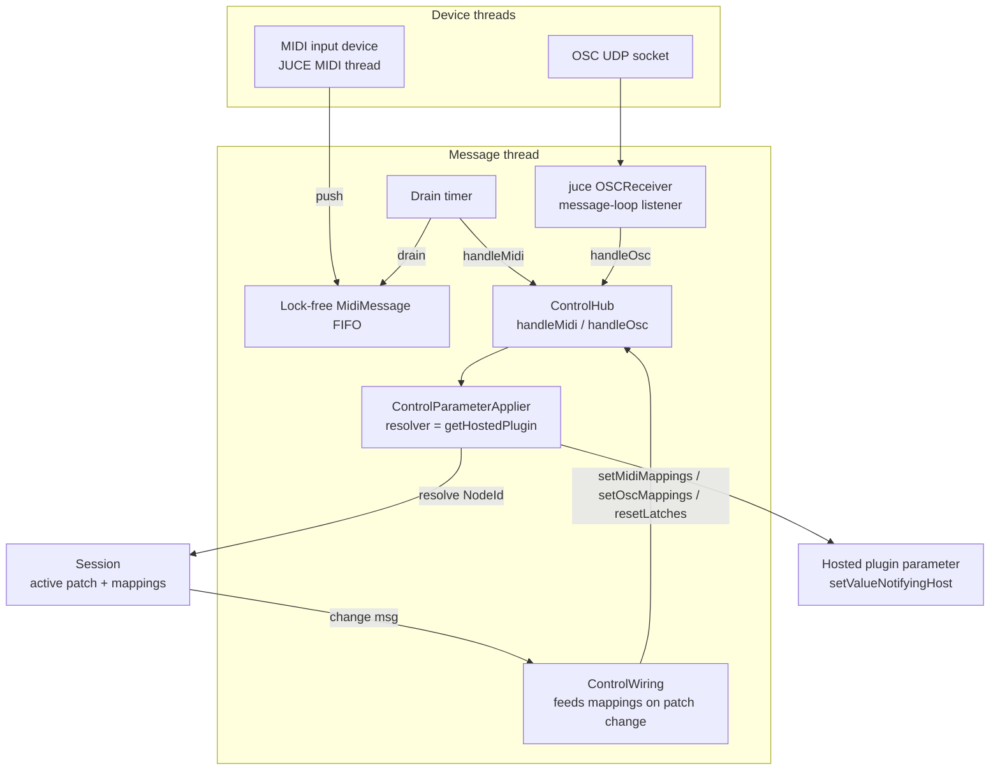

# Live MIDI/OSC Control (M2) - Plan

## Goal Capsule

- **Objective:** Wire the already-built, unit-tested-but-inert Phase 4 control layer to live devices so hardware MIDI and incoming OSC move real plugin parameters in the running app, including MIDI learn end-to-end and persisted/v2-imported mappings.
- **Origin:** `docs/plans/2026-07-02-001-feat-road-to-1-0-release-plan.md` milestone M2, requirements R6–R9. This plan is the HOW for that milestone; it does not re-scope the roadmap.
- **Product Contract preservation:** Product Contract unchanged — R6–R9 carried verbatim from the roadmap.
- **Open blockers:** none. The control logic (`session::ControlHub`, `control::MidiRouter`/`MidiControlSurface`, `control::OscRouter`, `session::ControlParameterApplier`) exists and is headless-tested; only device/socket integration and app wiring are missing.

---

## Product Contract

### Summary

Construct `session::ControlHub` in the app, bind its parameter resolver to the live graph, and re-feed patch mappings on every patch change. Add two device layers that feed the hub's existing seams: a live MIDI input path (a `juce::MidiInputCallback` marshalled to the message thread) and an OSC listener (`juce::OSCReceiver` on a configurable port). Add a minimal per-node MIDI-learn affordance sufficient to bind a controller to a parameter end-to-end. The full mappings-management dialog stays in M4.

### Problem Frame

Pedalboard 3's defining purpose is MIDI/OSC control of every parameter, but the control layer reaches no device: there is no `MidiInputCallback` and no `OSCReceiver` anywhere in `app-v3/src`, and nothing constructs `ControlHub`. The logic below it is complete — routing, latch, range/invert, MIDI learn, OSC multicast validation, MIDI-over-OSC, and parameter application are all written and covered by ~130 headless tests. The gap is purely integration: build the device/socket edges, construct the hub, and connect it to the `Session`'s active patch.

Two facts shape the work. First, the Audio Settings dialog already exposes MIDI-input device enablement (`AudioDeviceSelectorComponent` with `showMidiInputOptions`), and that enablement is persisted in the audio-device state XML the app already saves — so M2 adds the *consuming* callback, not new device-selection UI. Second, `Session` is a `juce::ChangeBroadcaster` and already carries a `patchGeneration` counter (added in M1), so mappings can be re-fed and latches reset on whole-patch swaps using the pattern the canvas already uses to close editors.

### Requirements

- R6. Live MIDI device input reaches the control layer: messages from enabled MIDI inputs feed mappings, learn, latch, and parameter application in the running app.
- R7. An OSC listener with a configurable port (and multicast per the existing `isOscMulticastAddress` validation) feeds the same control path.
- R8. MIDI learn works end-to-end from a physical controller to a plugin parameter.
- R9. Mappings already persisted in a `.pdl` drive live control after load, including v2-imported mappings.

### Scope Boundaries

**In scope:** constructing and wiring `ControlHub`; live MIDI input; live OSC input with configurable port + multicast; a minimal MIDI-learn affordance; persistence round-trip of mappings to live control.

**Deferred for later (M4 and beyond):**
- The per-plugin mappings-management dialog: editing range/invert/latch, deleting mappings, listing all mappings, authoring OSC and app-command mappings by hand (R12).
- App-level command mappings (next/previous patch via key/MIDI/OSC) and the `PatchSelect`/`AppCommand` unhandled-target dispatch — these depend on multi-patch (M3) and the command manager (R13). M2 installs the unhandled-target sink as a no-op stub so those events are dropped cleanly rather than misapplied.
- The redesigned settings modal. M2 adds only a minimal OSC-port control; the broader settings UI is a separate track.

**Outside this milestone's identity:** MIDI *output* (a MIDI Out node, roadmap R16) and transport/MMC (R15) are not control-input concerns and stay in M6.

### Dependencies / Assumptions

- Live verification of R6/R7/R8 requires hardware: a real MIDI controller and an OSC sender (e.g., TouchOSC) on a desktop build (macOS or Windows QA). The Linux dev server can build, unit-test the new headless seams, and exercise the message-plumbing logic, but cannot confirm a physical knob moves a parameter — that is an on-hardware verification-matrix item.
- MIDI-input *enablement* is assumed to remain owned by `AudioDeviceSelectorComponent` and persisted via the existing audio-device state XML. M2 consumes that enablement; it does not add a parallel device picker.
- `session.getHostedPlugin(NodeId)` returns the current hosted `juce::AudioProcessor*` looked up per call, so a resolver bound once stays correct across patch swaps (stable by id, not by cached pointer).

---

## Key Technical Decisions

- **KTD1 — MIDI marshals through a lock-free FIFO drained on a message-thread timer; OSC uses JUCE's default message-loop callback.** MIDI input callbacks arrive on a dedicated high-priority MIDI thread and a knob sweep emits a rapid CC stream; `MessageManager::callAsync` per message would allocate and flood the message queue. A single-producer/single-consumer lock-free ring of fixed-size `juce::MidiMessage` slots, drained by a `juce::Timer` on the message thread, is allocation-free on the hot path and is exactly what `ControlHub`'s header prescribes. `juce::OSCReceiver` (default construction) already dispatches listeners on the message thread, so OSC needs no manual marshalling — its listener calls `ControlHub::handleOsc` directly.

- **KTD2 — The node resolver is `session.getHostedPlugin(id)`, bound once; mappings are re-fed by a dedicated wiring object, not by `Session`.** `Session` stays unaware of `ControlHub` (no upward dependency). A small `ControlWiring` object listens to `Session` change messages and pushes the active patch's mappings into the hub. It resets latches only on a `patchGeneration` change (whole-patch swap), and re-feeds mappings when a mapping revision changes — so an unrelated Session change never spuriously resets live latch state (note: `setMidiMappings` resets latch internally, so re-feeding must be gated on an actual mapping change).

- **KTD3 — Reuse existing MIDI-device enablement.** The Audio Settings dialog already toggles and persists MIDI inputs. The MIDI layer registers its callback for the currently-enabled inputs and re-syncs when `AudioDeviceManager` broadcasts a change, rather than introducing a second device-selection surface.

- **KTD4 — OSC port persists in `Preferences` (default 9000); multicast reuses `isOscMulticastAddress`.** A minimal port control writes the value; the server binds on construction and rebinds on change. Multicast group membership is validated with the existing helper before joining.

- **KTD5 — MIDI learn ships with a minimal per-node affordance; the full dialog is M4.** M2 proves R8 end-to-end via a lightweight "MIDI Learn" action on a plugin node that picks one parameter, arms `ControlHub::armMidiLearn`, captures the next learnable message, and persists the resulting mapping to the patch. Range/invert/latch editing, mapping lists, and OSC/app-command authoring are the M4 dialog's job.

---

## High-Level Technical Design

Data flow from device to plugin parameter. New M2 components are the two device edges and the wiring object; everything below `ControlHub` already exists.

---

## Implementation Units

### U1. Construct and wire ControlHub

- **Goal:** `ControlHub` is constructed by the app, its resolver is bound to the live graph, and the active patch's mappings feed it on every patch change. After this unit, feeding `handleMidi`/`handleOsc` moves a real parameter — the device edges (U2/U3) just supply that input.
- **Requirements:** R9 (persisted mappings become live once input exists); groundwork for R6/R7/R8.
- **Dependencies:** none.
- **Files:**
  - `app-v3/src/AppContext.h` (add `session::ControlHub& controlHub`)
  - `app-v3/src/App.h`, `app-v3/src/App.cpp` (own the hub + wiring; construct after `Session`, before `AppContext`; tear down before `Session`)
  - `app-v3/src/session/ControlWiring.h`, `app-v3/src/session/ControlWiring.cpp` (new — listens to `Session`, feeds mappings)
  - `app-v3/src/session/Session.h`, `.cpp` (add a `mappingsRevision()` accessor bumped whenever `activePatch_.midiMappings`/`oscMappings` change, including on patch load; expose the active patch's mappings — already available via `getActivePatch()`)
  - `app-v3/src/session/CMakeLists.txt` (add `ControlWiring`)
  - `app-v3/tests/unit/session/ControlWiring_test.cpp` (new)
- **Approach:** `ControlWiring` holds `ControlHub&` + `Session&`, registers as a `Session` change listener, and caches the last-seen `patchGeneration` and `mappingsRevision`. On a change: if the generation advanced, call `setMidiMappings` + `setOscMappings` + `resetLatches` (new patch); else if only the mapping revision advanced, call `setMidiMappings` + `setOscMappings` without `resetLatches` (a learn/edit added a mapping mid-patch). Bind the resolver once at construction: `hub.setNodeResolver([&session](NodeId id){ return session.getHostedPlugin(id); })`. Install a no-op `setUnhandledTargetSink` (M4/M3 own real handling). Feed once at construction so a patch restored before the first change message is covered.
- **Patterns to follow:** the `patchGeneration` change-detection pattern in `app-v3/src/ui/SignalCanvas.cpp` (`changeListenerCallback` comparing a cached generation); `PreferencesPersister`'s Session-listener lifecycle for register/deregister ordering.
- **Test scenarios:**
  - Covers R9. A `Session` loaded with a patch carrying MIDI mappings, driven through a fake resolver: after the wiring feeds the hub, a `handleMidi` CC matching a mapping moves the resolved parameter.
  - Whole-patch swap (generation change) re-feeds mappings and resets latch state (a previously-toggled latch reads off after swap).
  - A mapping-revision-only change re-feeds mappings but does **not** reset an existing latch's toggle state.
  - An unrelated `Session` change (e.g., a node position update) with no mapping change does not re-feed (latch state preserved) — assert via a spy hub or by observing latch continuity.
  - Deregistration: destroying `ControlWiring` before `Session` stops it receiving further change messages (no use-after-free).
- **Verification:** headless tests pass; the app constructs and tears down cleanly (message-thread smoke on a desktop build); a patch with mappings drives a parameter when fed synthetic MIDI.

### U2. Live MIDI input

- **Goal:** Messages from enabled MIDI input devices reach `ControlHub::handleMidi` on the message thread.
- **Requirements:** R6.
- **Dependencies:** U1.
- **Files:**
  - `app-v3/src/control/MidiInputManager.h`, `app-v3/src/control/MidiInputManager.cpp` (new — `juce::MidiInputCallback` + lock-free FIFO + drain `juce::Timer`)
  - `app-v3/src/control/CMakeLists.txt`
  - `app-v3/src/App.cpp` (construct the manager, hand it the `AudioDeviceManager` and a `handleMidi` sink)
  - `app-v3/tests/unit/control/MidiInputManager_test.cpp` (new)
- **Approach:** `handleIncomingMidiMessage` (MIDI thread) copies the `juce::MidiMessage` into a preallocated ring managed by a `juce::AbstractFifo`; on overflow, drop and increment a dropped-count (control loss is preferable to blocking the MIDI thread). A `juce::Timer` on the message thread (≈120 Hz) drains all available messages and calls the injected `handleMidi` sink. Registration: enable the callback for each currently-enabled MIDI input via `AudioDeviceManager::addMidiInputDeviceCallback`, and re-sync the registered set when the `AudioDeviceManager` broadcasts a change (it is a `ChangeBroadcaster`). Split the FIFO+drain into a sink-agnostic core (constructed with a `std::function<void(const juce::MidiMessage&)>`) so it is headless-testable without a device.
- **Execution note:** the FIFO/drain core is the testable seam — write its scenarios first; the device registration is thin glue verified on hardware.
- **Patterns to follow:** JUCE `AbstractFifo` SPSC usage; `TransportBar`'s existing `AudioDeviceManager` access via `ctx_.audioEngine.getDeviceManager()`.
- **Test scenarios:**
  - Happy path: pushing N messages from a simulated producer results in exactly those N messages delivered to the sink, in order, after a drain.
  - Edge: draining an empty FIFO delivers nothing and does not spin or fault.
  - Edge: overflow when the ring is full drops messages and increments the dropped-count rather than blocking or corrupting the ring; subsequent drains still deliver the retained messages intact.
  - Integration: a CC pushed through the manager's sink into a real `ControlHub` (with a fake resolver) moves the mapped parameter — proves the manager→hub contract, not just the queue.
- **Verification:** headless FIFO/drain tests pass; on a desktop build with a controller, moving a mapped CC changes the plugin parameter (R6, hardware).

### U3. Live OSC input

- **Goal:** An OSC listener on a configurable port (with optional multicast) feeds `ControlHub::handleOsc`.
- **Requirements:** R7.
- **Dependencies:** U1.
- **Files:**
  - `app-v3/src/control/OscServer.h`, `app-v3/src/control/OscServer.cpp` (new — wraps `juce::OSCReceiver` + `OSCReceiver::Listener`)
  - `app-v3/src/control/CMakeLists.txt`
  - `app-v3/src/session/Preferences.h`, `.cpp` (add typed OSC port + optional multicast-address accessors over the existing `PropertiesFile`)
  - `app-v3/src/App.cpp` (construct the server with the port from `Preferences` and a `handleOsc` sink)
  - `app-v3/tests/unit/control/OscServer_test.cpp`, `app-v3/tests/unit/session/Preferences_test.cpp` (extend)
- **Approach:** `OscServer` owns a default-constructed `juce::OSCReceiver` (message-loop callback, so the listener fires on the message thread) and registers itself as an `OSCReceiver::Listener<...>` that forwards each `juce::OSCMessage` to the injected `handleOsc` sink. `connect(port)` binds; `disconnect()`/rebind on port change. When a multicast address is configured, validate it with `control::isOscMulticastAddress` before joining; reject invalid addresses with a surfaced error rather than a silent no-bind. Bind failure (port in use) surfaces a non-fatal error the app logs and the user can correct via the port control (U5). `Preferences` gains `getOscPort()/setOscPort()` (default 9000) and `getOscMulticastAddress()/setOscMulticastAddress()` over the existing `getStore()` `PropertiesFile`.
- **Patterns to follow:** `Preferences`' existing typed accessors over `getStore()`; the multicast validation already unit-tested in `app-v3/tests/unit/control/OscMapping_test.cpp`.
- **Test scenarios:**
  - Happy path: an `OSCMessage` delivered to the server's listener path forwards verbatim to the `handleOsc` sink (drive the listener callback directly; do not require a live socket in the unit test).
  - Error: an invalid multicast address is rejected (no join) and reported; a valid one passes the `isOscMulticastAddress` gate.
  - Error: a bind failure is reported as a non-fatal error, not a crash or silent success.
  - Integration: an OSC message routed through a real `ControlHub` (fake resolver) with a matching OSC mapping moves the mapped parameter.
  - Preferences: OSC port and multicast address round-trip through save/reload with the documented default when unset.
- **Verification:** headless tests pass; on a desktop build, TouchOSC (or an OSC sender) on the configured port moves a mapped parameter (R7, hardware).

### U4. MIDI learn end-to-end (minimal affordance)

- **Goal:** From the running app, a user binds a controller to a specific plugin parameter: arm learn for a chosen parameter, move the controller, and the mapping is created, live, and persisted.
- **Requirements:** R8.
- **Dependencies:** U1, U2.
- **Files:**
  - `app-v3/src/session/Session.h`, `.cpp` (add `addMidiMapping(control::MidiMapping)` — append to `activePatch_.midiMappings`, bump the mapping revision from U1, notify)
  - `app-v3/src/ui/PluginCard.h`, `.cpp` (a "MIDI Learn" action)
  - `app-v3/src/ui/SignalCanvas.cpp` (or a small `app-v3/src/ui/MidiLearnController.{h,cpp}`) to host the arm→capture→persist flow and the parameter picker
  - `app-v3/tests/unit/session/Session_test.cpp` (extend — `addMidiMapping`)
  - `app-v3/tests/unit/control/` learn-capture coverage already exists (`MidiControlSurface_test`, `ControlHub_test`); add a session-level mapping-mutation test only
- **Approach:** The learn affordance on a node opens a minimal picker of the plugin's parameter names (`getHostedPlugin(id)->getParameters()`), the user selects one, and the controller calls `ControlHub::armMidiLearn(cb)`. The next learnable MIDI message (arriving via U2) is captured by the existing surface, suppressed from routing, and delivered to `cb` as a `control::MidiSource`. The callback builds a `control::MidiMapping{ source, target = { PluginParameter, node, paramIndex } }` with default full range, calls `Session::addMidiMapping`, which bumps the mapping revision so `ControlWiring` (U1) re-feeds the hub — the new mapping is immediately live. It persists because it now lives in `activePatch_.midiMappings`, which `getActivePatchWithState`/`patchToXml` already serialize. Only one learn is armed at a time (`ControlHub::isLearning`), with a visible armed state and a cancel path.
- **Patterns to follow:** `ControlHub::armMidiLearn`/`isLearning`/`cancelMidiLearn` (already tested); `PluginCard`'s existing button/callback wiring; `Session`'s existing incremental mutators (`setNodeCustomName`) for the append+notify shape.
- **Test scenarios:**
  - `addMidiMapping` appends to the active patch, bumps the mapping revision, and fires a change message; the mapping survives `getActivePatchWithState`.
  - Covers R8 (capture→persist logic, headless): given an armed hub and a synthetic learnable CC, the resulting mapping's source matches the CC and its target matches the chosen node+parameter (drive `armMidiLearn` + `handleMidi` directly).
  - Edge: a non-learnable message (e.g., note-off) while armed does not create a mapping and leaves learn armed.
  - Edge: cancel while armed creates no mapping and re-enables normal routing.
  - Integration: after learn persists a mapping, a subsequent matching CC (through the live path) moves the parameter without re-arming.
- **Verification:** session/capture tests pass; on a desktop build, the arm→move-controller→parameter-moves loop works and the mapping survives save/reload (R8, hardware).

### U5. OSC port control + persistence round-trip verification

- **Goal:** The user can set the OSC port from the app, and a `.pdl` (v3 or v2-imported) with mappings drives live control after load with no manual step.
- **Requirements:** R7 (config surface), R9 (verification).
- **Dependencies:** U1, U3.
- **Files:**
  - `app-v3/src/ui/TransportBar.cpp` (a minimal OSC-port field/entry near the existing Audio Settings affordance, or a small menu item; writes `Preferences::setOscPort` and asks `OscServer` to rebind)
  - `app-v3/tests/unit/session/` (extend a patch-load test to assert mappings reach a hub through `ControlWiring` after a load, including a v2-imported patch)
- **Approach:** Add the smallest usable OSC-port control — a numeric entry that persists via `Preferences` and triggers an `OscServer` rebind; surface a bind error inline. R9 is delivered by U1's change-listener (it feeds whatever mappings the active patch holds, including v2-imported ones), so this unit's R9 work is a verification test that closes the loop end-to-end rather than new plumbing: load a patch (v3 and a v2-imported fixture) with mappings and assert a matching MIDI/OSC event moves a parameter through the fully wired path.
- **Patterns to follow:** `TransportBar`'s existing settings/menu affordances; the v2-import mapping fixtures in `app-v3/tests/unit/session/PdlV2Importer_test.cpp`.
- **Test scenarios:**
  - Covers R9. A v3 `.pdl` with MIDI+OSC mappings, loaded via `Session`, drives the corresponding parameters through the wired hub with no manual mapping step.
  - Covers R9. A v2-imported patch's mappings likewise reach the hub after load.
  - OSC port change: setting a new port persists it and rebinds the server (assert via the `Preferences` value and an `OscServer` rebind spy).
  - `Test expectation: none` for the pure layout of the port field beyond "it persists and rebinds."
- **Verification:** load-to-live-control tests pass; on a desktop build, changing the OSC port rebinds and a previously-saved patch controls parameters immediately after load (R7/R9, hardware for the live half).

---

## Verification Contract

| Gate | Command | Applies to |
|---|---|---|
| Build (Linux dev) | `cmake --build build/linux-dev` | all units |
| Unit tests | `ctest --test-dir build/linux-dev --output-on-failure` | all units (headless seams) |
| Format | `clang-format` clean on changed `app-v3/src` + tests | all units |
| MIDI hardware | manual: enabled controller + mapped CC moves a parameter | U2, U4 (R6, R8) |
| OSC hardware | manual: OSC sender on configured port moves a parameter | U3, U5 (R7) |
| Persistence | manual: save a learned mapping, reload, control still works | U4, U5 (R9) |

The hardware gates are on-desktop (macOS/Windows QA) per the project's agent-native verification matrix; the Linux dev server verifies build, headless seams, and the message-plumbing logic only.

## Definition of Done

- R6: enabled MIDI inputs drive mapped parameters in the running app.
- R7: an OSC listener on a configurable port (with multicast support) drives mapped parameters; the port is user-settable and persisted.
- R8: a user binds a controller to a parameter via the minimal learn affordance, end-to-end, and the mapping persists.
- R9: mappings loaded from a v3 or v2-imported `.pdl` drive live control immediately after load.
- All new headless seams (`ControlWiring`, MIDI FIFO/drain, `OscServer` forwarding, `Session::addMidiMapping`, `Preferences` OSC accessors) are unit-tested and green; the full suite passes.
- The unhandled-target sink is a clean no-op stub (PatchSelect/AppCommand dropped, not misapplied) pending M3/M4.

---

## Sources / Research

- `docs/plans/2026-07-02-001-feat-road-to-1-0-release-plan.md` — M2 requirements R6–R9, milestone ordering.
- Control-layer API (verified 2026-07-04): `app-v3/src/session/ControlHub.h` (seams `handleMidi`/`handleOsc`, `setNodeResolver`, `armMidiLearn`, `setUnhandledTargetSink`, `resetLatches`); `app-v3/src/session/ControlParameterApplier.h` (`NodeResolver = std::function<juce::AudioProcessor*(NodeId)>`); `app-v3/src/control/MidiControlSurface.{h,cpp}` (learn arm/capture/suppress); `app-v3/src/control/OscMapping.{h,cpp}` (`isOscMulticastAddress`, `midiFromOsc`); `app-v3/src/session/Patch.h` (`midiMappings`/`oscMappings` fields, `patchToXml`/`patchFromXml`).
- Wiring points: `app-v3/src/App.cpp` (construction sequence: `Session` → `AppContext` → `MainWindow` → restore); `app-v3/src/AppContext.h` (reference bundle to extend); `app-v3/src/engine/AudioEngine.h` (`getDeviceManager()`); `app-v3/src/ui/TransportBar.cpp` (`AudioDeviceSelectorComponent` with `showMidiInputOptions` already persists MIDI enablement); `app-v3/src/session/Preferences.h` (`getStore()` + audio-device-state accessors).
- Existing control tests to build on (already green): `app-v3/tests/unit/control/*` and `app-v3/tests/unit/session/{ControlHub,ControlParameterApplier}_test.cpp` — ~130 headless cases covering routing, latch, learn, range/invert, OSC multicast, MIDI-over-OSC.
- Verified 2026-07-04: no `MidiInputCallback`/`addMidiInputDeviceCallback` and no `juce::OSCReceiver`/socket bind exist anywhere in `app-v3/src`.
